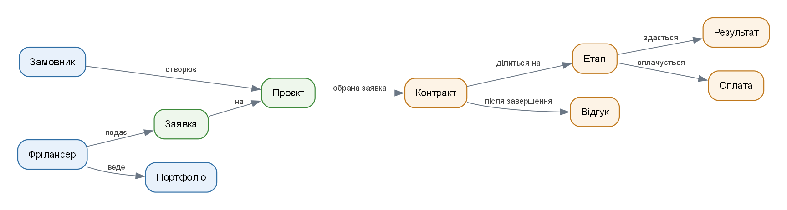
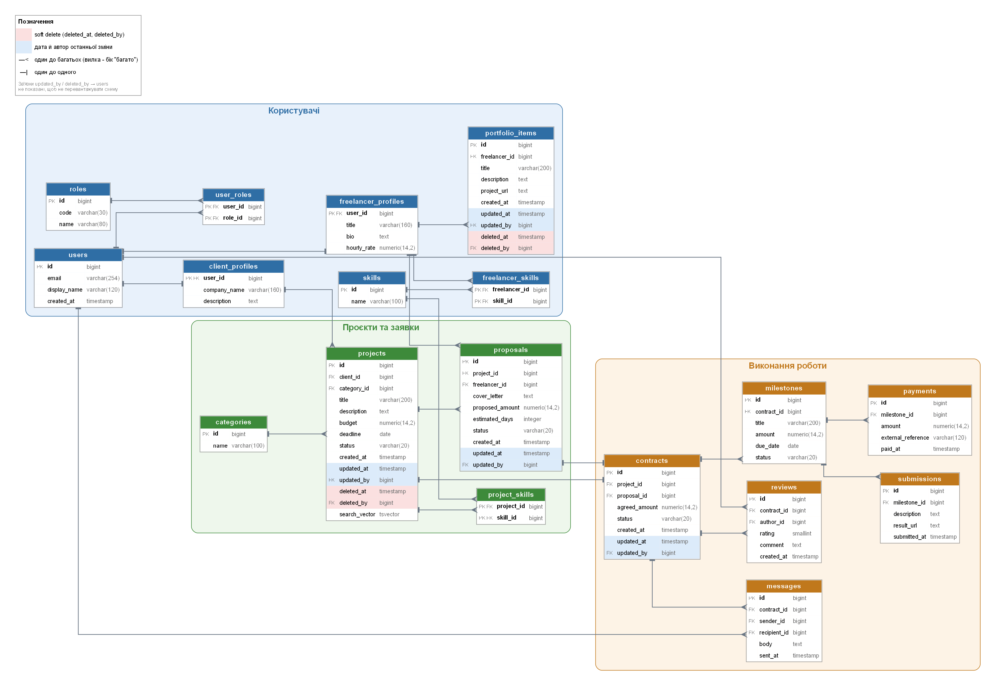
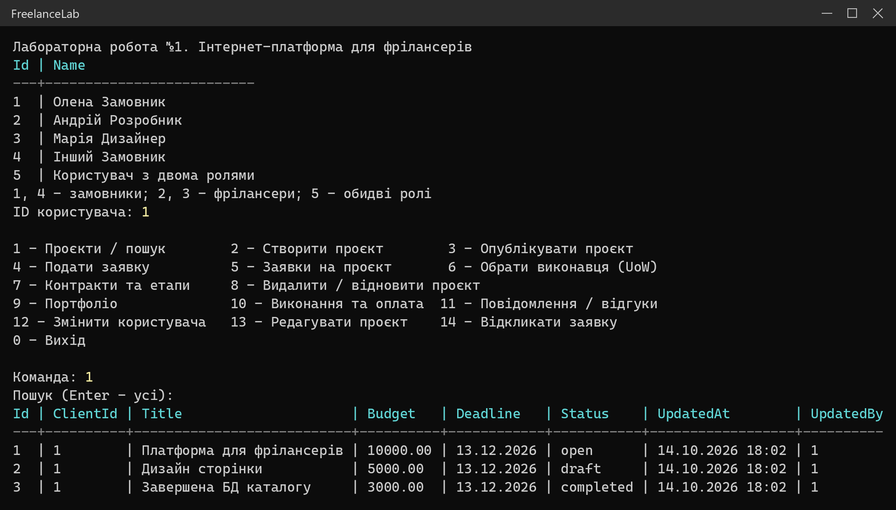
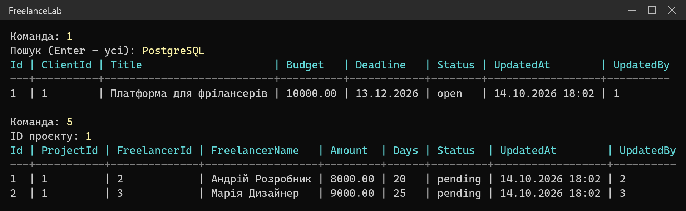
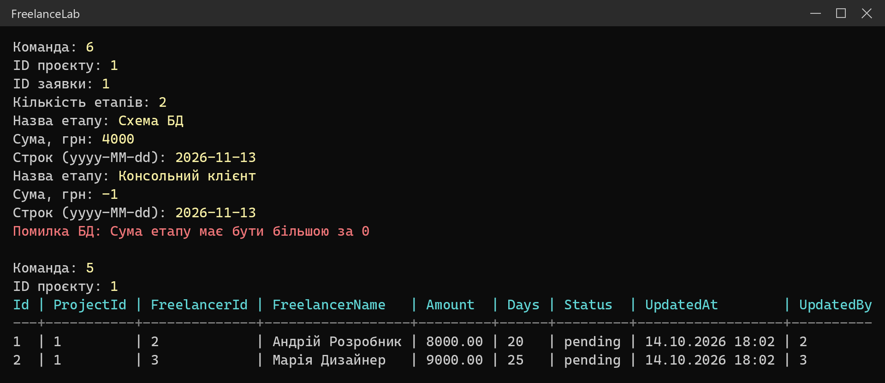
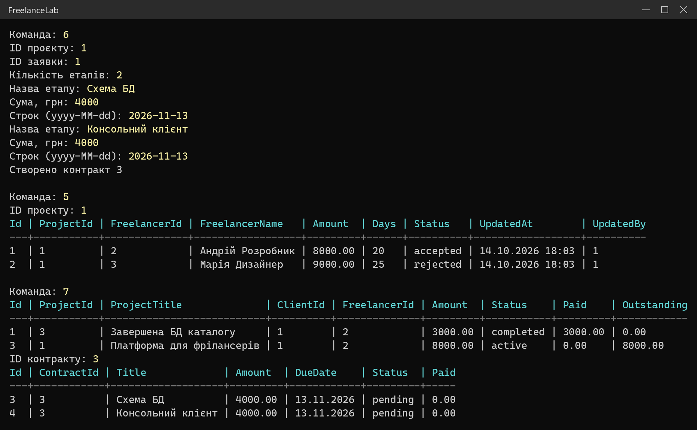
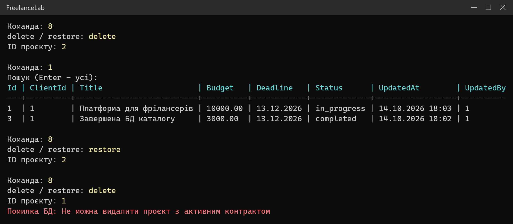
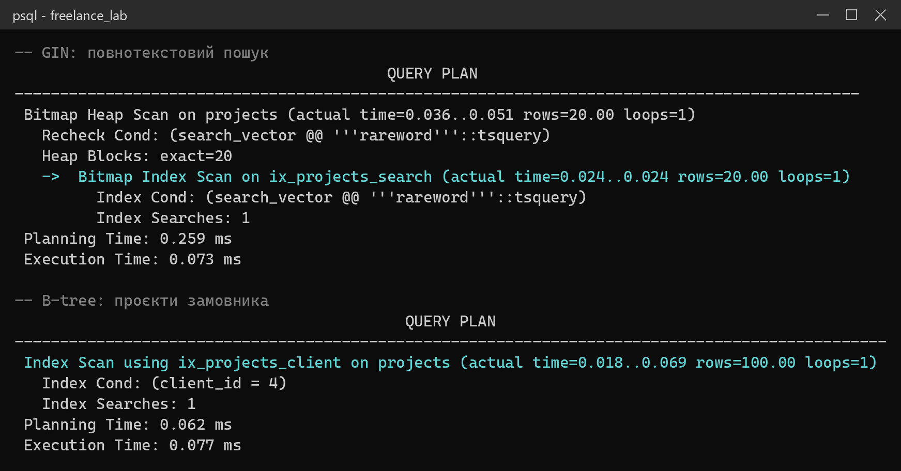

# Лабораторна робота №1

**Варіант 7. Інтернет-платформа для фрілансерів**

СУБД: PostgreSQL · Застосунок: C# (.NET 10, Npgsql)

## Про застосунок

Це база даних для сайту на кшталт Upwork або Freelancehunt. Замовник публікує
проєкт з бюджетом і строком, фрілансери подають на нього заявки. Замовник обирає
одну заявку, і з виконавцем укладається контракт, розбитий на етапи. Фрілансер
здає результат кожного етапу, замовник його приймає й оплачує. Після завершення
обидві сторони залишають відгук.

Для демонстрації написано консольну програму. Вона працює з базою тільки через
збережені процедури та представлення (View).



## Схема бази даних

18 таблиць, поділених на три частини: користувачі, проєкти із заявками та
виконання роботи. Рожевим позначені поля soft delete, блакитним дата й автор
останньої зміни.



Ту саму схему можна відкрити на [dbdiagram.io](https://dbdiagram.io), якщо
вставити в редактор файл [docs/schema.dbml](docs/schema.dbml).
Вимоги до системи описано в [docs/requirements.md](docs/requirements.md).

## Що реалізовано

| Вимога | Реалізація |
|---|---|
| Схема БД | ER-діаграма вище, `docs/schema.dbml` |
| Мінімум 15 сутностей | 18 таблиць |
| Soft delete | `projects`, `portfolio_items` (`deleted_at`, `deleted_by`) |
| Дата й автор зміни | `projects`, `proposals`, `contracts`, `portfolio_items` (`updated_at`, `updated_by`) |
| Реляційна СУБД | PostgreSQL, скрипти в папці `sql` |
| Процедури, функції, тригери, View | 19 процедур, 2 функції, 6 тригерів, 10 View |
| Індекси | B-tree, GIN (повнотекстовий пошук), унікальний частковий |
| Repository + Unit of Work | `src/FreelanceLab/Data` |

## Як це працює

**Збережені процедури** (`sql/03_procedures.sql`) виконують усі зміни даних:
створення проєкту, подання заявки, вибір виконавця, оплату етапу, soft delete
і відновлення тощо. Усередині процедур перевіряються правила, наприклад, що
не можна подати заявку на власний проєкт.

**Тригери** (`sql/02_functions_triggers.sql`) автоматично оновлюють
`updated_at` при зміні запису й забороняють фізичний `DELETE` у таблицях
із soft delete.

**View** (`sql/04_views_indexes.sql`) використовуються для читання.
Наприклад, `vw_active_projects` показує тільки не видалені проєкти.

**Repository + Unit of Work.** Кожен репозиторій відповідає за свою сутність.
Unit of Work відкриває одне підключення й одну транзакцію та передає їх усім
репозиторіям. Найкраще це видно у виборі виконавця (`Services/AwardService.cs`):
прийняття заявки, створення контракту, додавання етапів і зміна статусу проєкту
відбуваються в одній транзакції. Якщо хоч один крок не вдався, відкочується все.

## Скриншоти

**Запуск програми.** Вибір користувача, меню, список проєктів.



**Повнотекстовий пошук проєктів і перегляд заявок.**



**Unit of Work, відкат.** Другий етап має некоректну суму, БД повертає помилку.
Транзакція відкочується, і обидві заявки залишаються `pending`.



**Unit of Work, успішний вибір виконавця.** Заявку 1 прийнято, заявку 2
відхилено, створено контракт із двома етапами.



**Soft delete.** Видалений проєкт 2 зникає зі списку, потім його відновлюємо.
Проєкт з активним контрактом видалити не можна.



**Використання індексів** (`sql/06_index_demo.sql`, 10 000 тестових записів).
Пошук іде через GIN-індекс, вибірка за замовником через B-tree.



## Запуск

```
createdb -U postgres freelance_lab
psql -U postgres -d freelance_lab -f sql/01_schema.sql
psql -U postgres -d freelance_lab -f sql/02_functions_triggers.sql
psql -U postgres -d freelance_lab -f sql/03_procedures.sql
psql -U postgres -d freelance_lab -f sql/04_views_indexes.sql
psql -U postgres -d freelance_lab -f sql/05_seed.sql
dotnet run --project src/FreelanceLab
```

За замовчуванням програма підключається до `localhost:5432` (база
`freelance_lab`, користувач `postgres`, пароль `postgres`). Інші параметри можна
задати через змінну середовища `FREELANCE_CONNECTION`.

Тестові користувачі: 1 і 4 — замовники, 2 і 3 — фрілансери, 5 має обидві ролі.
