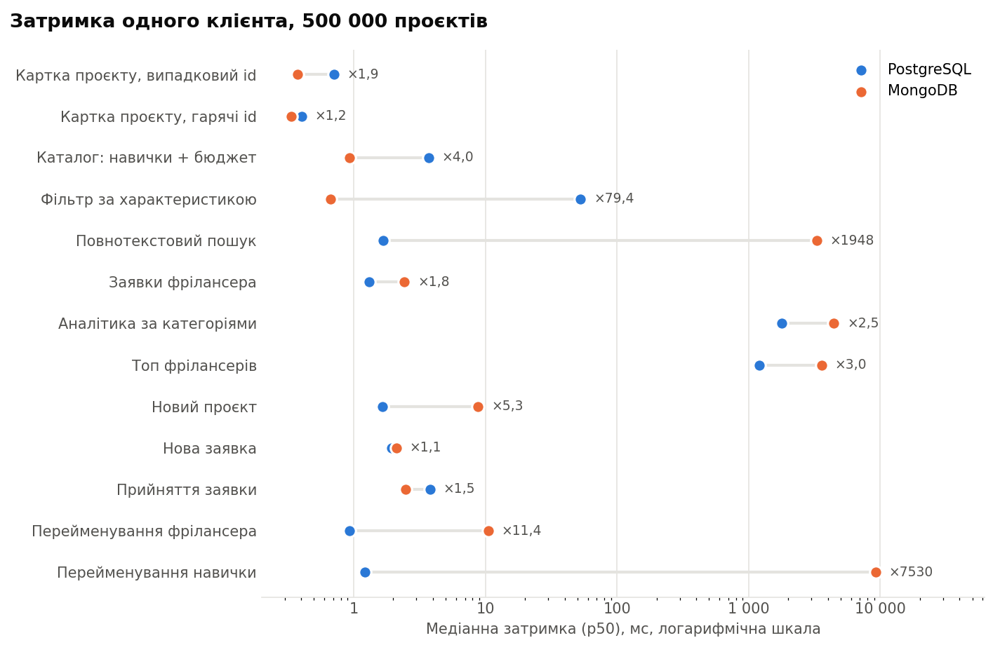
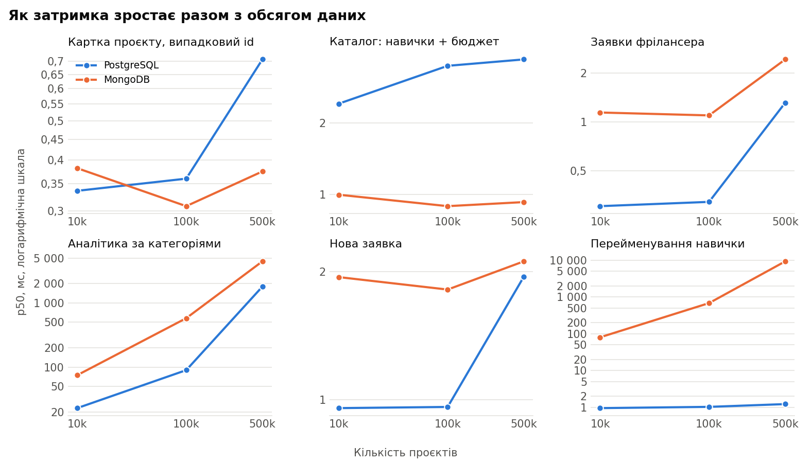

# Лабораторна робота №2. NoSQL

**Варіант 7. Інтернет-платформа для фрілансерів** (продовження Лабораторної №1)

СУБД: MongoDB 8.0, PostgreSQL 18, Redis 8.2 · Бенчмарк: C# (.NET 10)

## 1. Види NoSQL баз

| Вид | Приклади | Де знадобився б на платформі |
|---|---|---|
| Документна | MongoDB, CouchDB | Картка проєкту разом із заявками |
| Ключ-значення | Redis, DynamoDB | Кеш, сесії, лічильники, рейтинги |
| Широкостовпцева | Cassandra, HBase | Журнал подій, коли записів дуже багато |
| Графова | Neo4j | Рекомендації фрілансерів зі схожими навичками |

## 2. Що виносимо в NoSQL

Контракти, етапи й оплати залишаються в PostgreSQL: для грошей потрібні транзакції
й зовнішні ключі. У MongoDB виношу каталог проєктів. Для цього вимоги з
Лабораторної №1 розширено:

- кожна категорія має власні характеристики (у дизайну формат і кількість сторінок,
  у баз даних рушій і розмір);
- картку проєкту читають набагато частіше, ніж змінюють, а в SQL вона збирається
  з 9 таблиць;
- на проєкт можна подати не більше 50 заявок, тож документ не росте без меж.

Мінуси такого рішення теж є. Імена користувачів і навичок копіюються в кожен документ,
а запити впоперек документів (наприклад, усі заявки одного фрілансера) стають дорожчими.
Ці випадки теж є в тесті.

## 3–4. Реалізація в MongoDB і PostgreSQL

Код: [MongoStore.cs](src/CatalogBench/MongoStore.cs),
[SqlStore.cs](src/CatalogBench/SqlStore.cs), [схема](sql/01_schema.sql),
[індекси](sql/02_indexes.sql). Середній розмір документа 3,6 КБ:

```js
{
  _id: 10, title: "...", description: "...", budget: Decimal128("1349.48"),
  deadline: ISODate("..."), status: "open", createdAt: ISODate("..."), updatedAt: ISODate("..."),
  category: { id: 10, name: "Video" },
  client: { id: 191, name: "Client 191", company: "Company 191" },
  skills: [ { id: 13, name: "skill-013" }, ... ],
  attrs: [ { k: "style", v: "motion" }, ... ],
  proposals: [ {
    id: 31, freelancer: { id: 65841, name: "Freelancer 65841", title: "Specialist 1" },
    coverLetter: "...", amount: Decimal128("1284.59"), days: 22, status: "pending", createdAt: ISODate("...")
  }, ... ]
}
```

| Частина документа | Таблиці PostgreSQL |
|---|---|
| Основні поля | `projects` |
| `category` | `categories` |
| `client` | `users`, `client_profiles` |
| `skills` | `project_skills`, `skills` |
| `attrs` | `project_attributes` (нова таблиця, EAV) |
| `proposals` | `proposals`, `users`, `freelancer_profiles` |

Характеристики записані парами `k`/`v`, тому всі категорії покриває один індекс.
Схема PostgreSQL взята з Лабораторної №1 без полів soft delete і `updated_by`, бо на
порівняння вони не впливають.

## 5. Тестування швидкодії

Сценарії відповідають сторінкам сайту: картка, каталог, фільтр за характеристикою,
пошук, заявки фрілансера, аналітика, створення проєкту, подання й прийняття заявки.
Окремо виміряно перейменування фрілансера й навички (тут денормалізація має коштувати
найбільше) і змішане навантаження: 80% картка, 15% каталог, 5% нові заявки.

Умови:

- **Обсяг:** 10 000, 100 000 і 500 000 проєктів (до 2 144 852 заявок). На 500 000 дані
  вже не вміщаються в кеш: PostgreSQL займає 2,6 ГБ разом з індексами, MongoDB 1,4 ГБ.
- **Дані:** однакові для обох баз, з детермінованого генератора. Популярні навички й
  активні користувачі трапляються частіше, на проєкт у середньому близько 5 заявок.
- **Ресурси:** кожна база має 4 ядра, 2 ГБ пам'яті й кеш 512 МБ. Клієнт працює в
  контейнері на окремих ядрах.
- **Запис:** у MongoDB з `j: true`, щоб він так само чекав диска, як `COMMIT` у PostgreSQL.
- **SQL:** картка читається батчем із 4 підготовлених запитів за один мережевий обмін.
- **Замір:** 1 і 16 потоків, 3 раунди, порядок баз чергується, у таблицях медіана.
  Читання: 2 с прогріву й 5 с заміру. Для запису обидві бази отримують однаковий список змін.

Щоб порівняння було чесним, команда `verify` до і після замірів звіряє кількість записів,
500 вибірок кожного запиту й аналітику. На всіх обсягах результати збіглися. Також 16
одночасних заявок на 50-те місце в обох базах дали рівно одну успішну.

Під час налагодження знайшлися дві розбіжності, які довелося виправити:

- `$text` у MongoDB шукає слова в лапках як підрядок (`lovi` знаходиться в `kalovi`),
  тому пошук в обох базах зроблено через логічне АБО;
- PostgreSQL сортував назви за локаллю, а MongoDB побайтово, тому додано `COLLATE "C"`.

### Результати на 500 000 проєктів

Усі обсяги зведено в [summary.md](measurements/summary.md), сирі дані й плани запитів
лежать у папці `measurements`.



| Сценарій | p50 PG, мс | p50 Mongo, мс | оп/с PG, 16 потоків | оп/с Mongo, 16 потоків |
|---|---:|---:|---:|---:|
| Картка, випадковий id | 0,71 | 0,38 | 13 061 | 21 604 |
| Картка, гарячі id | 0,40 | 0,34 | 16 817 | 26 142 |
| Каталог: навички + бюджет | 3,73 | 0,93 | 1 103 | 6 107 |
| Фільтр за характеристикою | 52,82 | 0,67 | 69 | 9 850 |
| Повнотекстовий пошук | 1,69 | 3 285 | 3 004 | 1,1 |
| Заявки фрілансера | 1,32 | 2,43 | 10 228 | 1 597 |
| Аналітика за категоріями | 1 794 | 4 435 | — | — |
| Топ фрілансерів | 1 197 | 3 569 | — | — |
| Новий проєкт | 1,66 | 8,82 | 1 646 | 279 |
| Нова заявка | 1,95 | 2,12 | 5 009 | 2 172 |
| Прийняття заявки | 3,82 | 2,48 | 2 041 | 2 511 |
| Перейменування фрілансера | 0,93 | 10,57 | — | — |
| Перейменування навички | 1,23 | 9 224 | — | — |
| Змішане навантаження (p50 на 16 потоках) | 1,62 | 0,97 | 4 010 | 11 252 |



### Аналіз

**Картка.** MongoDB швидша лише в 1,2–1,9 раза. На 10 000 проєктів із випадковим id
PostgreSQL для одного клієнта навіть трохи випереджає її (0,34 проти 0,38 мс).

**Фільтр за характеристикою (Mongo ×79).** У MongoDB складений індекс одразу дає 20
найновіших документів: план читає 20 ключів і 20 документів. У PostgreSQL характеристики
лежать окремо від `status` і `created_at`, тому в прикладі база знаходить 2125 проєктів,
читає кожен і лише потім сортує. З примусовим обходом за датою час майже не змінився
(29 мс проти 26 мс), отже, винна схема EAV, а не невдалий план.

**Пошук (PG ×1948).** Розрив залежить від слова. Для поширених слів PostgreSQL іде
індексом за датою й зупиняється на 20-му збігу, а `$text` читає всі збіги (у прикладі
184 240 документів) і сортує їх. Для рідкісного слова з 6 958 збігами вийшло близько
8 мс у PostgreSQL і 438 мс у MongoDB, хоча в MongoDB сюди входить ще й підрахунок збігів.

**Заявки фрілансера.** PostgreSQL бере 20 рядків з індексу, а MongoDB читає всі документи
з цим фрілансером, розгортає масиви й сортує. На одному потоці різниця ×1,8, на 16 — ×6,4.

**Аналітика (PG ×2,5–3).** Обидві бази читають усі дані, але PostgreSQL виконує запит
паралельно (`Gather Merge` у плані).

**Запис.** Нова заявка для одного клієнта коштує майже однаково, а на 16 потоках PostgreSQL
пропускає в 2,3 раза більше. Створення проєкту в MongoDB сповільнюється з обсягом: 2,05 мс
на 10 000 і 8,82 мс на 500 000. Причину не досліджено, можливо, це оновлення текстового
індексу. Прийняття заявки швидше в MongoDB лише на 500 000, а на 100 000 швидший PostgreSQL
(×1,4). Без очікування диска нова заявка на 16 потоках зростає з 5 009 до 7 691 оп/с у
PostgreSQL і з 2 172 до 4 186 оп/с у MongoDB.

**Перейменування.** У PostgreSQL змінюється один рядок, близько 1 мс на будь-якому обсязі.
У MongoDB перейменування популярної навички переписує 98 550 документів, менш популярної
7 690, медіана 9,2 с. До того ж оновлення не атомарне: поки воно триває, частина документів
має стару назву.

**Змішане навантаження (Mongo ×2,8).** Різницю дає переважно каталог: за p50 його 15% запитів
забирають у PostgreSQL більше часу, ніж 80% читань картки.

**Сховище.** Дані займають 837 МБ у MongoDB і 2100 МБ у PostgreSQL, індекси 550 і 534 МБ.
Завантаження з побудовою індексів тривало 106 с і 122 с відповідно.

### Обмеження

- Усе запущено на одній машині, без реплікації.
- Тексти синтетичні, і найбільше це впливає на пошук.
- Аналітику виконано 3 рази за раунд, перейменування навички 4 рази, пошук у MongoDB
  на 500 000 лише кілька разів, тому p95 і p99 для цих сценаріїв ненадійні.
- Холодний старт окремо не вимірювався.
- `jsonb` у PostgreSQL не тестувався, хоча він міг би прибрати слабке місце EAV.

## 6. Інший тип NoSQL: Redis

Другою базою обрано Redis (ключ-значення). Він підходить для короткоживучих даних і
простих частих операцій. Запити: [basic_queries.sh](redis/basic_queries.sh), вивід:
[redis_output.txt](measurements/redis_output.txt).

| Задача | Структура | Команди |
|---|---|---|
| Кеш картки на 60 с | STRING | `SET ... EX`, `GET`, `TTL`, `EXISTS`, `DEL` |
| Лічильник переглядів | STRING | `INCR`, `INCRBY` |
| Ліміт заявок за годину | STRING | `INCR`, `EXPIRE` |
| Сесія користувача | HASH | `HSET`, `HGET`, `HGETALL` |
| Хто онлайн і має потрібну навичку | SET | `SADD`, `SISMEMBER`, `SINTER`, `SREM`, `SCARD` |
| Останні переглянуті проєкти | LIST | `LPUSH`, `LTRIM`, `LRANGE` |
| Рейтинг фрілансерів | ZSET | `ZADD`, `ZINCRBY`, `ZREVRANGE`, `ZREVRANK`, `ZSCORE`, `ZRANGEBYSCORE` |
| Атомарна зміна двох ключів | транзакція | `MULTI`, `EXEC` |
| Пошук ключів без блокування | | `SCAN` |

## 7. Висновки

MongoDB виграє, коли запит читає один документ або йде одним складеним індексом: каталог
×4, фільтр за характеристикою ×79. PostgreSQL виграє, коли дані потрібні впоперек документів
або змінюється спільне значення: заявки фрілансера, аналітика, перейменування навички
(1,2 мс проти 9,2 с). На швидкий пошук через `$text` для поширених слів розраховувати
не варто.

Одна лише картка окремої бази не виправдовує, бо виграш менший ніж удвічі. Виносити каталог
у MongoDB має сенс, якщо характеристики довільні, а читань дуже багато. Тоді гроші й
контракти лишаються в PostgreSQL, а прийняття заявки потребує синхронізації між двома базами,
бо спільної транзакції в них немає. Для невеликого проєкту достатньо PostgreSQL, і спершу
варто спробувати `jsonb`.

## Запуск

Потрібні Docker і .NET 10 SDK, команди виконуються з папки `Lab2`. Повний прогін трьох обсягів
триває близько двох годин.

```
docker compose up -d
dotnet build -c Release src/CatalogBench
docker compose run --rm bench load 100000
docker compose run --rm bench verify 100000
docker compose run --rm bench explain 100000
docker compose run --rm bench bench 100000 3
py scripts/summarize.py
docker compose exec -T redis sh < redis/basic_queries.sh
```
